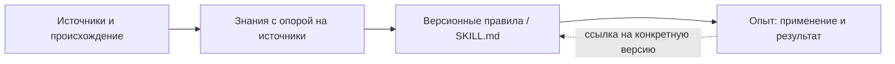

# AI-wisdom

### От источников — к знаниям, правилам и опыту применения

[](https://github.com/tohich51/AI-wisdom/releases/tag/v0.1.0-beta.1)
[](LICENSE)
[](https://t.me/aisaassolution)

[Релиз](#релиз) · [Установка](#установка) · [Архитектура](#архитектура-и-доступ) · [MCP](#mcp) · [English](README.en.md)

AI-wisdom — библиотека знаний на собственной инфраструктуре для владельца и приглашённых коллег. Она помогает сохранять происхождение материалов, находить опубликованные знания, вести версии правил и отдельно фиксировать их применение и результаты. Браузерный интерфейс и защищённый MCP работают с одним каталогом и одинаковыми правилами доступа.

Проект **ИИдея** — авторская разработка, исследования ИИ, прототипы и практические продукты. Разработка AI-wisdom велась через Hermes. [Сайт студии](https://aisaassolution.com) · [Telegram @aisaassolution](https://t.me/aisaassolution).

В публичном репозитории — только исходный код: без пользовательских книг, данных, учётных записей, секретов и наполненных баз. Материалы добавляете вы.

## Что умеет beta

- **Принимать источники с происхождением:** PDF, EPUB, DOCX, HTML и текст. Для сканированных PDF возвращается `needs_ocr`; встроенного OCR-сервиса нет.
- **Готовить черновики знаний и правил:** модельная задача запускается явно; результат требует одобрения куратора перед публикацией.
- **Искать опубликованное:** лексический и векторный поиск без вызова генеративной модели. Если векторная проекция недоступна или некорректна, переход к лексическому поиску явно обозначается.
- **Хранить неизменяемые опубликованные версии правил:** исправление создаёт новую версию. Экспорт `SKILL.md` не устанавливает и не запускает навык.
- **Фиксировать применение и результаты:** выдача в поиске означает «показано», а не «использовано», «успешно» или «доказано». Неизвестные метаданные остаются неизвестными.



Это смысловой путь, а не автоматическая публикация: происхождение и ссылки на источники сохраняются, повторно используемые правила версионируются, а опыт относится к конкретной версии. Типизированные смысловые связи и близость эмбеддингов — разные представления; сходство не доказывает связь.

## Релиз

**Public beta:** версия Python-пакета `0.1.0b1`, тег [`v0.1.0-beta.1`](https://github.com/tohich51/AI-wisdom/releases/tag/v0.1.0-beta.1). Это идентификаторы выпуска, а не свидетельство прохождения проверок.

Полный стек — **семь сервисов на rootless Podman + Quadlet**. Это не переносимый установщик «одной командой» и не гарантия промышленной стабильности. Порядок настройки и проверок: [руководство public beta](docs/public-beta.md).

## Архитектура и доступ

```text
Browser / MCP client -> gateway -> PostgreSQL (authoritative rights and records)
                           |          ^
                           |       worker -> MiniMax subscription runner
                           |          |
                           +-> OpenViking <- single indexer
                                  |
                           OpenRouter embeddings
Keycloak OIDC -> authenticated identity at the gateway
```

- **Gateway + PostgreSQL:** PostgreSQL — источник истины для прав на библиотеки, происхождения, опубликованных версий и опыта. Runtime-роли не являются суперпользователями, не имеют `BYPASSRLS` и используют row-level security (RLS). Без идентичности доступ запрещён. Тип библиотеки и аудитория независимы; участие в проекте не даёт доступа к связанным библиотекам.
- **Keycloak:** OIDC-аутентификация на gateway. Настройка OIDC и scopes — по [руководству установки](docs/public-beta.md); правила доступа одинаковы для браузера и MCP.
- **OpenViking:** перестраиваемая проекция `vectors_only`, не база авторизации. Единственный indexer; профиль эмбеддингов OpenRouter — `qwen/qwen3-embedding-8b`, размерность **4096**.
- **Worker + отдельный model runner:** генерация через подписочный MiniMax runner с `MiniMax-M3.1-Flash-Preview`. Автоматического перехода на API key или pay-as-you-go нет.

Нужны собственные разрешённые учётные записи и credentials провайдеров; лимиты подписок действуют. Инференс, кредиты и подписки не включены. Внешний CLI не поставляется в репозитории; границы его лицензии описаны в руководстве установки.

## Установка

### Пакет и CLI из чистого клона

Требуются Linux x86_64, **Python 3.11 или 3.12** с `venv` и pip, Git, Bash, [`just`](https://github.com/casey/just) и доступ к индексу Python-пакетов. Команды устанавливают пакет и средства проверки разработки; они **не запускают полный стек и не настраивают аутентификацию**.

```sh
git clone https://github.com/tohich51/AI-wisdom.git
cd AI-wisdom
git checkout --detach v0.1.0-beta.1
git rev-parse HEAD
python3 --version                 # must be 3.11.x or 3.12.x
python3 -m venv .venv
.venv/bin/python -m pip install --upgrade pip
.venv/bin/python -m pip install -r requirements.lock
.venv/bin/python -m pip install -e '.[dev,pgtest]'
.venv/bin/python -m pip check
.venv/bin/kb --help
just check
.venv/bin/python -m pip wheel --no-deps --wheel-dir dist .
just package
```

Недоступный тег — ошибка, а не разрешение незаметно проверить другую ветку. Предпубликационные проверки владельца выпуска используют точный собранный commit-кандидат. `requirements.lock` фиксирует зависимости; побитовая воспроизводимость build backend Hatchling не заявляется. `just package` собирает комплект исходников, а не работающий deployment.

`just integration` требует настоящего PostgreSQL. `just acceptance` требует реальных сервисов и runtime evidence; ни одна из этих проверок не подразумевается результатом `just check`. Если обязательную проверку нельзя выполнить, gate должен закрыться с ошибкой. Отсутствие сервисов, пропущенные проверки или отсутствие подтверждения владельца не означают успешный выпуск.

### Полный стек

Перед активацией прочитайте [public beta setup](docs/public-beta.md): семь сервисов, локальная сборка образов, миграции существующей базы, очередь, создание первого владельца, подписочный launcher, OIDC, credentials провайдеров и соответствие шаблонов вашей установке.

| Компоненты | Документация |
| --- | --- |
| Gateway, worker, model runner, indexer | [Product Quadlets](deploy/quadlet/README.md) |
| PostgreSQL, Keycloak, OpenViking | [Infrastructure Quadlets](deploy/xorek/README.md) |
| Миграции и эксплуатационные меры защиты | [Runtime runbook](docs/runbooks/runtime.md) |

Примеры deployment и runbook могут содержать пути конкретной установки. Используйте переносимые соответствия из beta-руководства; не копируйте секреты другого оператора.

## MCP

Аутентифицированный MCP endpoint предоставляет доступ к тому же каталогу и под теми же правами, что и браузер. Поиск сохраняет опору на источники; выдача не считается применением правила. Дополнительный [SDK MCP client](clients/mcp/README.md) имеет отдельные инструкции установки и проверок.

## Ограничения beta

Глобальное объединение сущностей и кластеризация не реализованы. Генерации аудио, видео и слайдов нет. Сканированные PDF требуют отдельного OCR.

Нет подтверждённого заявления о промышленной стабильности или часовом нагрузочном тесте. **Холодный ответ за 1–2 секунды не гарантируется.** Перед использованием изучите [ограничения и проверки выпуска](docs/public-beta.md#limitations-and-release-checks).

## Лицензия и ИИдея

Собственный код AI-wisdom распространяется по [лицензии MIT](LICENSE). Она не меняет лицензии внешних CLI-пакетов и не включает инференс, кредиты, подписки или права на загружаемый контент. За учётные записи, условия использования и права на материалы отвечает оператор.

**ИИдея** — исследования ИИ и авторские продукты. [aisaassolution.com](https://aisaassolution.com) · [Telegram](https://t.me/aisaassolution).
