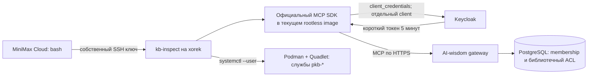

# MiniMax Cloud: работа с AI-wisdom

Владелец разрешил подключение и настройку 11 октября 2026. Эта инструкция уточняет старый read-only handoff: облачному агенту разрешён SSH к своему проекту и серверный MCP-клиент. Секреты не нужно переносить в облачную песочницу.

## Подключение и проверка

```sh
ssh kb-inspect@150.241.115.134
cat /home/kb-inspect/CLOUD-MCP-ACCESS.md
/home/kb-inspect/.local/bin/ai-wisdom-agent doctor
/home/kb-inspect/.local/bin/ai-wisdom-agent tools
/home/kb-inspect/.local/bin/ai-wisdom-agent call list_libraries '{}'
/home/kb-inspect/.local/bin/ai-wisdom-agent call search_knowledge '{"query":"маркетинг","limit":5}'
```

Ключ остаётся в workspace MiniMax. На сервере установлен предоставленный публичный ключ с fingerprint `SHA256:24+uRxNnycI/nuoFIyqRvIg+0AVVPtvLoYmY44/qCT0`. ED25519 fingerprint нового сервера: `SHA256:5e9llHtgZJ2FWKGlQeB3UH85bqMUXxMleuxb7l3cwns`. Сверить ключ сервера при первом входе; проверку host key не отключать. Динамический IP облачной песочницы разрешён.

`doctor` должен вернуть `status: ok`, `transport: mcp_via_ssh_server_client`, собственную identity и десять реальных инструментов. Это соединение доступно через `bash` и SSH. Нативная регистрация `ai-wisdom` в списке инструментов MiniMax Cloud по прежнему отчёту среды отсутствует; наличие моста её не создаёт. Утверждать, что облачный доступ проверен, можно после выполнения команды из самой песочницы и получения её ответа.

## Как устроен доступ



Keycloak client `kb-minimax-cloud` использует отдельный service account. Его principal: `2f28ea11-5a22-43a9-adb6-004d79362054`; organisation: `bbcbb06e-641d-401c-9a7b-ad7ac817d80f`. Gateway проверяет signature/issuer/audience и активное членство; библиотечный ACL/RLS применяется при каждом вызове. Client secret хранится на сервере в `/home/kb-inspect/ai-wisdom-config/minimax-cloud-client.json`, mode 0600. Команда получает токен в памяти; отдельной команды печати токена нет. OAuth владельца в Codex и подписочный профиль MiniMax не используются для доступа к базе.

Продуктовая роль — активный участник. Администрирование всей организации не выдано. Агент становится manager созданных им библиотек; к существующим приватным библиотекам нужны отдельные grants. SSH-роль — уже разрешённый maintainer продукта: она управляет собственными контейнерами и закрытой конфигурацией проекта. Этот административный доступ к серверу не является границей конфиденциальности между недоверенными людьми; для чтения знаний клиент всегда проходит штатный gateway ACL.

## Настройка библиотек и проектов

В SSH-сессии можно читать настройки и выполнять конкретные задачи владельца:

```sh
ai-wisdom-agent api GET /api/library-types
ai-wisdom-agent api GET /api/libraries
ai-wisdom-agent api POST /api/libraries '{"organisation_id":"bbcbb06e-641d-401c-9a7b-ad7ac817d80f","name":"Маркетинг","kind":"reference","audience_scope":"private"}'
```

Не создавать библиотеку из примера в ходе проверки подключения: владелец загружает свои материалы сам. При создании библиотеки по задаче владельца выдать ему manager через `PUT /api/libraries/<id>/grants` с телом `{"principal_id":"a0b197e1-ef15-46f5-81e0-6e0153b94c9f","role":"manager"}`. Это публичный идентификатор текущего владельца, сверенный Codex при настройке; credential-файлы владельца читать не нужно. Сам владелец может выдать grants агенту на свои библиотеки обычным API/UI.

Клиент разрешает GET `/api/me`, `/api/library-types`, `/api/libraries`, отдельной библиотеки и её `/sources`, `/knowledge`, `/rules`, `/grants`, проекта и его `/context`. Настройка: POST `/api/library-types`, `/api/libraries`, `/api/projects`, `/api/projects/<id>/libraries`, `/api/projects/<id>/rules`; PUT `/api/libraries/<id>/grants`. Gateway отдельно проверяет права. Произвольные URL, auth/admin endpoints, приглашения и неизвестные MCP tools клиент отклоняет. Все десять штатных MCP tools доступны; операции записи выполнять только в рамках конкретной задачи владельца.

## Разработка и развёртывание

- Актуальный отдельный checkout: `/home/kb-inspect/projects/AI-wisdom-agent`. Проверить `git status --short`, `git rev-parse HEAD` и инструкции перед правками. Старый `/home/kb-inspect/projects/AI-wisdom` сохранён.
- Рабочий gateway/worker image соответствует runtime commit `27e1cb16159c207444f7ee88da728cd39ebe0338`. Добавление этого клиента не пересобирает и не перезапускает gateway. Wrapper берёт immutable image ID фактически работающего `pkb-gateway`; SDK уже входит в него.
- Rootless Podman 4.9.3; Quadlets `/home/kb-inspect/.config/containers/systemd`. Разрешены службы `pkb-postgres`, `pkb-keycloak`, `pkb-gateway`, `pkb-worker`, `pkb-model-runner`. Общая slice 8 GiB; отдельный контейнер клиента ограничен 256 MiB и 0.5 CPU.
- Канонические данные `/home/kb-inspect/ai-wisdom-data`, конфигурация `/home/kb-inspect/ai-wisdom-config`, версии `/home/kb-inspect/ai-wisdom-releases`. Перед rollout проверить jobs/generation, локальные gates, image/source identity и rollback. Перезапускать только затронутые службы; сохранять данные.
- Подписочное исполнение модели: `/home/kb-inspect/.local/bin/mmx-subscription`, проверенный OAuth, модель `MiniMax-M3.1-Flash-Preview`. PAYG/API-key fallback не разрешён. Эмбеддинги остаются заглушкой; OpenViking выключен до выбора провайдера.

Серверный клиент запускается без sudo, read-only, с dropped capabilities, без runtime sockets и с TLS verification. Для подключения SDK контейнер обращается к существующему HTTPS gateway/identity. Изменения Caddy, firewall, SSH других пользователей, соседних Docker/DB, reboot, GitHub push, публикация материалов и приглашение людей не входят в текущую область.

## Проверки и отзыв

Codex проверяет реальный маршрут от kb-inspect: tools/list, поиск, API конфигурации, создание временных библиотек/проекта/связи, library grants и отказ HTTP/MCP для чужой private library. Все временные записи удаляются по точным ID; оригиналы/знания остаются пустыми. Receipt: `/home/kb-inspect/ai-wisdom-handoff/cloud-agent-access-live-receipt.json`. Это серверная проверка; самостоятельный запуск из MiniMax Cloud отмечается отдельным результатом.

Для отзыва продуктового доступа владелец отключает Keycloak client `kb-minimax-cloud` и деактивирует его membership штатным API. Deactivated membership блокирует каждый следующий gateway/MCP вызов, включая ещё не истёкший токен. Для полного отзыва административного SSH-доступа владелец отдельно удаляет предоставленный ключ MiniMax из `kb-inspect/authorized_keys`. При восстановлении старого backup сверить наличие новой identity и серверного client config; секреты не отправлять в чат.

Два CLI-пакета MiniMax не вернули артефакт (`max_tokens`, только thinking); клиент и независимая приёмка выполнены Codex как явный fallback. Подписочный маршрут не менялся.
